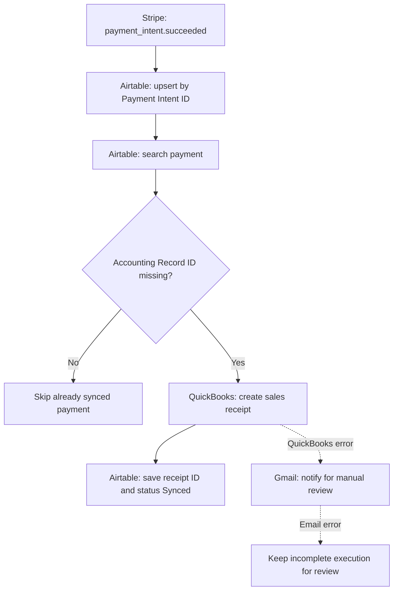

# InvoiceFlow — Stripe to QuickBooks Accounting Automation

**An event-driven accounting automation built with Make.com, Stripe, Airtable, QuickBooks Online, and Gmail.**

InvoiceFlow demonstrates how a successful Stripe test payment can be captured in a lightweight payment tracker, recorded as a QuickBooks Online sales receipt, and marked as synced in Airtable. A dedicated error route sends a Gmail notification when QuickBooks rejects a transaction.

> **Scope:** This is a sandbox proof of concept, not a live payment-processing deployment or a guaranteed exactly-once accounting integration. No real charges or client transactions are required.

## What it does

- Listens for successful Stripe `payment_intent.succeeded` events.
- Upserts payment information in Airtable using the Stripe Payment Intent ID.
- Finds the corresponding payment record and checks whether it already has an accounting record ID.
- Creates a **QuickBooks Online sales receipt** for payments that have not yet been synced.
- Updates Airtable with the QuickBooks receipt ID and `Synced` status after success.
- Sends a Gmail alert for QuickBooks errors so the transaction can be reviewed manually.
- Uses a sequential-processing configuration and a skip filter to reduce duplicate processing, without claiming exactly-once delivery.

## Technology stack

| Tool | Purpose |
| --- | --- |
| Make.com | Scenario orchestration and error routing |
| Stripe (test mode) | Payment event source |
| Airtable | Payment tracking and accounting status |
| QuickBooks Online (developer sandbox) | Sales receipt creation |
| Gmail | Error notification |

## Architecture



See [`docs/architecture.md`](docs/architecture.md) for a fuller explanation and [`docs/test-checklist.md`](docs/test-checklist.md) for the test checklist.

## Data mapping

| Destination | Source / mapping |
| --- | --- |
| Airtable Payment ID | Stripe Payment Intent ID |
| Airtable Amount | Stripe amount converted from minor units for USD (`amount / 100`) |
| Airtable Currency | Stripe currency |
| Airtable Payment Status | Stripe payment status |
| QuickBooks customer | Demo sandbox customer (replace with your own test customer) |
| QuickBooks item | Demo sandbox service item (replace with your own test item) |
| QuickBooks line amount | Airtable amount, quantity 1 |
| Airtable Accounting Status | `Synced` after QuickBooks confirms success |
| Airtable Accounting Record ID | QuickBooks Sales Receipt internal ID |

**Currency note:** Dividing by 100 applies to the USD tests here. Other currencies require appropriate handling of Stripe minor units and QuickBooks currency settings.

## Reproduce the sandbox workflow

1. Set up a **Stripe test-mode** account, **QuickBooks developer sandbox**, Airtable base, Gmail account, and Make.com scenario.
2. Create an Airtable `Payments` table with fields: `Payment ID`, `Customer Email`, `Amount`, `Currency`, `Payment Status`, `Accounting Status` (`Pending`, `Synced`, `Failed`), `Accounting Record ID`, and `Created At`.
3. Review the exported scenario in [`workflows/stripe-to-accounting.json.json`](workflows/stripe-to-accounting.json.json). Import a **sanitized** Make.com blueprint if the export format is supported, and reconnect **your own** accounts. Do not rely on the original webhook ID or credential references.
4. Create a new Stripe test webhook for `payment_intent.succeeded`. Configure Airtable mappings and the filter that passes only records without an accounting ID.
5. Select your own QuickBooks sandbox customer and service item. Map the amount and capture the resulting receipt ID.
6. Configure Gmail error alerts to a test address you control.
7. Run a new Stripe test transaction, confirm the QuickBooks sales receipt, then confirm that Airtable updates to `Synced`. Test a failed QuickBooks request separately.

The [`.env.example`](.env.example) file documents configuration names only. Make.com does **not** automatically load `.env` variables.

## Sandbox test evidence

These results were observed during development of the sandbox workflow:

| Test | Result |
| --- | --- |
| New Stripe successful payment | Payment followed the Stripe → Airtable → QuickBooks → Airtable route |
| QuickBooks sales receipts | Two $100 USD sandbox receipts were observed (document numbers `1038` and `1039`) |
| Airtable sync confirmation | A payment was marked `Synced` and stored QuickBooks internal receipt ID `146` |
| Reprocessed synced payment | Filter returned no eligible bundles, so QuickBooks was skipped for that run |
| QuickBooks validation failure | An invalid sandbox item caused `ValidationFault`; Gmail error notification was received |

Screenshots in [`screenshots/`](screenshots/) document the test scenario. They should contain **redacted or fictional identifiers only**.

## Screenshots

| Evidence | File |
| --- | --- |
| Make.com scenario overview | [`01-workflow-overview.png`](screenshots/01-workflow-overview.png) |
| Stripe test payment | [`02-stripe-payment.png`](screenshots/02-stripe-payment.png) |
| QuickBooks sandbox receipt | [`03-quickbooks-receipt.png`](screenshots/03-quickbooks-receipt.png) |
| Airtable synced payment | [`04-airtable-synced.png`](screenshots/04-airtable-synced.png) |
| Gmail error alert | [`05-gmail-error-alert.png`](screenshots/05-gmail-error-alert.png) |

## Limitations

- **Not exactly-once:** A QuickBooks receipt could be created even if the subsequent Airtable update fails. Reconcile any uncertain transaction in QuickBooks before retrying.
- QuickBooks customer and service item are selected for sandbox testing rather than dynamically matched to every Stripe transaction.
- Stripe `receipt_email` may be missing; `Created At` is not populated by the exported mapping.
- Errors outside the QuickBooks route may not trigger the same Gmail notification.
- No real-money payments, production credentials, refunds, disputes, or full multi-currency reconciliation are included.

## Security and privacy

Only publish **reviewed, sanitized** workflow exports and screenshots. Remove personal email addresses, live webhook URLs, account or workspace IDs, customer information, and tokens as appropriate. Never commit API keys, OAuth credentials, or secret values. The original Make.com blueprint may include account references even if it does not expose authentication tokens.

## Repository structure

```text
invoiceflow-automation/
├── README.md
├── .env.example
├── .gitignore
├── docs/
│   ├── architecture.md
│   └── test-checklist.md
├── screenshots/
│   ├── 01-workflow-overview.png
│   ├── 02-stripe-payment.png
│   ├── 03-quickbooks-receipt.png
│   ├── 04-airtable-synced.png
│   └── 05-gmail-error-alert.png
└── workflows/
    └── stripe-to-accounting.json.json
```

## About this project

A portfolio demonstration of payment-to-accounting automation and operational error handling, developed and tested in sandbox environments. All platform names and trademarks belong to their respective owners.
