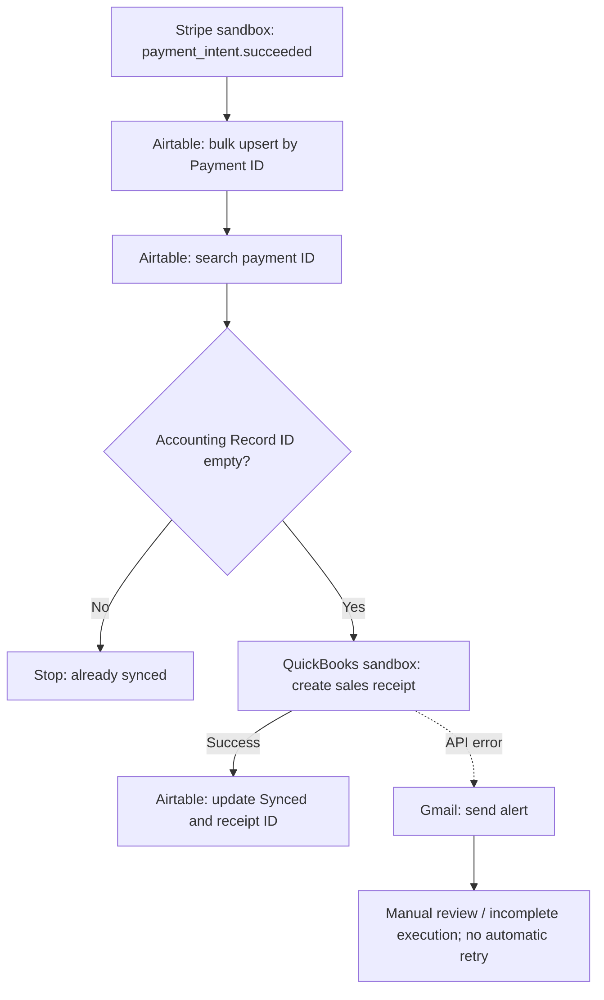

# Architecture and data contract

## Airtable `Payments` table

| Field | Type | Meaning |
|---|---|---|
| Payment ID | Single line text, primary | Stripe `pi_...` payment identifier |
| Customer Email | Email | Nullable; Stripe event may not provide it |
| Amount | Number, 2 decimals | Major currency units, e.g. 100.00 USD |
| Currency | Text | e.g. `usd` |
| Payment Status | Single select | e.g. `succeeded` |
| Accounting Status | Single select | `Pending`, `Synced`, `Failed`, `Needs Review` |
| Accounting Record ID | Single line text | QuickBooks internal sales receipt ID |
| Created At | Date/time | Optional Stripe event/payment timestamp |

**Identifiers are distinct:** Stripe payment ID `pi_...`; Airtable record ID `rec_...`; QuickBooks receipt internal ID (not necessarily the visible document number).

**Money conversion:** Stripe USD minor units 10000 → 100.00 USD. Do not divide twice; other currencies may use different exponent rules.

**Webhook security:** Only trusted Stripe events; restrict to successful payment intent events and protect credentials. Prefer built-in verified integration behavior; confirm signing/verification setup in actual environment.
